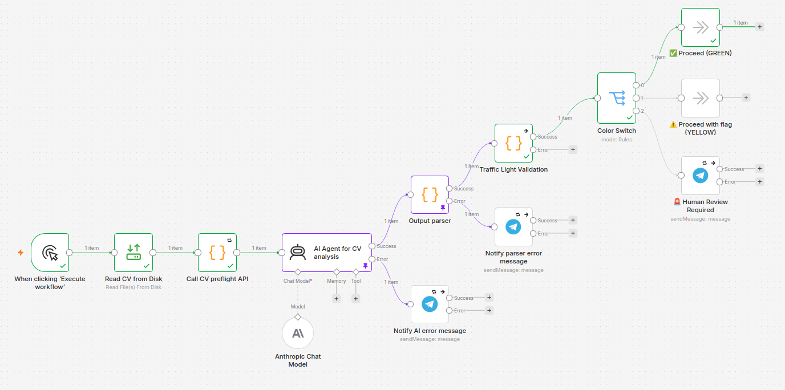

# CV Preflight

Microservizio per il **pre-flight check di leggibilità**, l'**estrazione testo** di CV in formati eterogenei (PDF nativo, PDF scansionato, DOCX, immagini) e il **rilevamento di agenzie HR intermediarie**. Deterministico, zero chiamate LLM.

Progetto pilota per l'automazione del processo di recruiting di una PMI italiana, in conformità con **GDPR**, **AI Act Europeo (art. 6)** e **CCNL italiano**.

**Versione attuale**: `1.1.1`

---

## 📖 In breve (per recruiter e stakeholder)

Questo sistema **automatizza la prima fase di screening dei CV**:

1. **Riceve un CV** (PDF, immagine, DOCX)
2. **Verifica se è leggibile** — se è una scansione sfocata o un formato strano, lo segnala
3. **Estrae i dati** in modo strutturato: nome, contatti, esperienze, competenze, lingue, disponibilità
4. **Riconosce se il CV arriva da un'agenzia HR** (con dati sensibili rimossi)
5. **Instrada il CV** verso il percorso corretto:
   - 🟢 **GREEN** → CV leggibile, procedi automaticamente
   - 🟡 **YELLOW** → CV leggibile con riserve, procedi con flag
   - 🔴 **RED** → CV illeggibile, richiede revisione umana

**Vantaggi**:
- ⏱️ **Tempo di valutazione**: da 20 minuti a **meno di 2 minuti** per CV
- 🎯 **Consistenza**: stesso CV + stessa JD → stesso risultato
- 📊 **Tracciabilità**: ogni decisione è tracciata con metriche oggettive
- 🛡️ **Compliance**: GDPR, AI Act, CCNL

---

## 🎯 Obiettivo

Prima di inviare un CV a un LLM per scoring e valutazione, il sistema:

1. **Classifica il rischio di leggibilità** del documento (GREEN / YELLOW / RED)
2. **Estrae il testo** con il metodo più appropriato (nativo o OCR)
3. **Calcola metriche oggettive** (densità testo, confidence OCR, rumore, lingua, rotazione)
4. **Rileva se il CV è passato da un'agenzia HR** (header agenzia + dati sensibili)
5. **Decide l'azione**: procedi, procedi con flag, oppure human review

Questo permette di:
- **Risparmiare chiamate LLM** su documenti illeggibili
- **Ridurre allucinazioni** (LLM lavora solo su testo pulito)
- **Evitare retry inutili** su CV anonimizzati da agenzie
- **Rispettare l'AI Act** (human-in-the-loop sui casi dubbi)
- **Garantire tracciabilità** (ogni decisione è motivata da metriche)

---

## 🏗️ Architettura

```
[File CV] → [Preflight Check] → GREEN/YELLOW/RED
                    ↓
              [Agency Detection]
                    ↓
       ┌────────────┴────────────┐
       │                         │
   GREEN/YELLOW              RED
       │                         │
       ↓                         ↓
[LLM Extraction]          [Human Review]
```

Il pre-flight check è **completamente deterministico**: nessuna chiamata LLM, nessuna variabilità, nessuna allucinazione possibile.

---

## 🔄 Pipeline completa (end-to-end)

Il sistema è composto da **due componenti principali** che lavorano insieme:

1. **`cv-extractor`** (microservizio Python) → preflight check deterministico
2. **`n8n`** (orchestratore) → workflow che chiama il microservizio + LLM + routing

### Diagramma del workflow n8n



### Flusso dettagliato

```
┌─────────────────────────────────────────────────────────────┐
│ 1. TRIGGER                                                  │
│    Manual Trigger (in produzione: IMAP trigger su email)    │
└─────────────────────────────────────────────────────────────┘
                            ↓
┌─────────────────────────────────────────────────────────────┐
│ 2. LETTURA CV                                               │
│    Read CV from Disk → /data/local-test-cvs/                │
└─────────────────────────────────────────────────────────────┘
                            ↓
┌─────────────────────────────────────────────────────────────┐
│ 3. PREFLIGHT CHECK (cv-extractor)                           │
│    - Rileva MIME                                            │
│    - Estrae testo (nativo/OCR)                              │
│    - Calcola metriche (score, lingua, rumore)               │
│    - Rileva agency protection                               │
│    - Classifica rischio (GREEN/YELLOW/RED)                  │
└─────────────────────────────────────────────────────────────┘
                            ↓
┌─────────────────────────────────────────────────────────────┐
│ 4. ESTRAZIONE LLM (AI Agent + Claude Sonnet)                │
│    - System prompt: regole + schema JSON                    │
│    - User prompt: raw_text + metadati preflight             │
│    - Temperatura 0 → determinismo                           │
│    - Output: JSON strutturato                               │
└─────────────────────────────────────────────────────────────┘
                            ↓
┌─────────────────────────────────────────────────────────────┐
│ 5. PARSING + VALIDAZIONE                                    │
│    - Converte stringa JSON in oggetto                       │
│    - Verifica campi obbligatori                             │
│    - Rispetta agency protection (campi attesi mancanti)     │
└─────────────────────────────────────────────────────────────┘
                            ↓
┌─────────────────────────────────────────────────────────────┐
│ 6. ROUTING (Color Switch)                                   │
│    - GREEN + valid  → ✅ Proceed (GREEN)                    │
│    - YELLOW + valid → ⚠️ Proceed with flag (YELLOW)         │
│    - RED o invalid  → 🚨 Human Review Required              │
└─────────────────────────────────────────────────────────────┘
                            ↓
┌─────────────────────────────────────────────────────────────┐
│ 7. AZIONI                                                   │
│    - GREEN/YELLOW: prosegui al matching con JD (Fase 22)    │
│    - RED/invalid: notifica Telegram al recruiter            │
└─────────────────────────────────────────────────────────────┘
```

### Cosa fa ogni nodo

| # | Nodo | Cosa fa | Perché è importante |
|---|---|---|---|
| 1 | **Manual Trigger** | Avvia il workflow | In produzione: trigger email/ATS |
| 2 | **Read CV from Disk** | Legge il CV dal filesystem | Test locale; in produzione: allegato email |
| 3 | **Call CV preflight API** | Chiama `cv-extractor` via HTTP | Estrazione testo + metriche deterministiche |
| 4 | **AI Agent for CV analysis** | Estrae dati strutturati con Claude | LLM lavora su testo già pulito |
| 5 | **Output parser** | Converte stringa JSON in oggetto | Normalizza l'output LLM |
| 6 | **Traffic Light Validation** | Verifica campi obbligatori | Blocca CV incompleti |
| 7 | **Color Switch** | Smista per `risk_class` + `valid` | Routing deterministico |
| 8 | **✅ Proceed (GREEN)** | Casi GREEN validi | Procedi automaticamente |
| 9 | **⚠️ Proceed with flag (YELLOW)** | Casi YELLOW validi | Procedi con flag di attenzione |
| 10 | **🚨 Human Review Required** | Casi RED o invalid | Notifica Telegram al recruiter |
| 11 | **Notify parser error message** | Errori parsing JSON | Tracciabilità errori |
| 12 | **Notify AI error message** | Errori AI Agent | Tracciabilità errori |

### Gestione errori

| Errore | Nodo | Azione |
|---|---|---|
| AI Agent fallisce | `Notify AI error message` | Telegram + log |
| JSON malformato | `Notify parser error message` | Telegram + log |
| CV illeggibile (RED) | `🚨 Human Review Required` | Telegram + human review |
| Campi obbligatori mancanti | `🚨 Human Review Required` | Telegram + human review |

### Data Pinning (per test senza costi)

Il workflow usa **Data Pinning** su:
- `AI Agent for CV analysis` 📌
- `Output parser` 📌

Questo permette di testare i nodi a valle (validazione, switch, Telegram) **senza rieseguire le chiamate LLM**, risparmiando token e tempo.

⚠️ **Importante**: il pinning funziona solo per esecuzioni manuali. In produzione, i dati pinned vengono ignorati.

### Import del workflow in n8n

1. n8n → **Workflows** → **Import from File**
2. Seleziona `workflows/fase21_cv_preflight.json`
3. Configura le credenziali:
   - **Anthropic**: la tua API key
   - **Telegram**: token del bot `Brick Point HR`
4. Verifica che `cv-extractor` sia raggiungibile: `http://cv-preflight-extractor:8080/health`
5. Esegui

### Prossimi step (Fase 22)

Il workflow Fase 21 si ferma all'estrazione. La **Fase 22** (scoring vs JD) aggiungerà:
- Input: JD strutturata
- Matching deterministico (competenze, anni, titoli)
- Scoring LLM (giudizio complessivo)
- Decisione finale + human-in-the-loop

---
## 📋 Roadmap

Le fasi successive (Fase 22-25) sono documentate in **[ROADMAP.md](ROADMAP.md)**.

| Fase | Descrizione | Stato |
|---|---|---|
| Fase 21 | Estrazione dati CV + routing | ✅ **Completa** |
| Fase 22 | Confronto con JD + scoring | 📋 Design |
| Fase 23 | Audit log + tracciabilità | 📋 Design |
| Fase 24 | Comunicazione esito candidato | 📋 Design |
| Fase 25 | Ingestion email reale (IMAP) | 📋 Design |

**Stima costi** (pipeline completa, 500 CV/mese, con cache intelligente): **~57€/mese** (budget disponibile: 500€/mese).

Vedi [ROADMAP.md](ROADMAP.md) per il design dettagliato di ogni fase.

---

## 📦 Stack

| Componente | Tecnologia |
|---|---|
| API | FastAPI + Uvicorn |
| PDF nativo | pdfplumber + PyMuPDF |
| PDF scansionato | OCRmyPDF + Tesseract (fallback PyMuPDF + Tesseract) |
| DOCX | python-docx |
| Immagini | Tesseract + Pillow |
| Rilevamento lingua | langdetect |
| Rilevamento MIME | python-magic |
| Agency detection | pyyaml + regex |
| Container | Docker |
| Orchestrazione | Portainer |
| Orchestratore workflow | n8n (dedicato, isolato) |
| LLM | Anthropic Claude Sonnet |
| CI/CD | GitHub Actions → GHCR |
| Email di test | Mailpit |

---

## 🚀 Deploy

### Prerequisiti

- Docker + Docker Compose
- Portainer (o Docker Compose CLI)
- Accesso a GHCR (il package è pubblico, quindi pull anonimo)
- **CV di test copiati in `/opt/cv-test-data/`** (vedi sezione "Ingestion del CV")

### Con Portainer

1. **Stacks** → **Add stack**
2. Nome: `cv-preflight`
3. **Build method**: **Repository**
4. **Repository URL**: `https://github.com/DavideNas/cv-preflight`
5. **Repository reference**: `refs/heads/main`
6. **Compose path**: `docker-compose.yml`
7. **Authentication**: ON (se repo privato) → username GitHub + PAT con scope `repo`
8. **Deploy the stack**

### Con Docker Compose (CLI)

```bash
git clone https://github.com/DavideNas/cv-preflight.git
cd cv-preflight
docker compose up -d
```

### Verifica

```bash
# Preflight service
curl http://localhost:8080/health
# → {"status":"ok","version":"1.1.1"}

# n8n (dedicato al test)
# Browser: http://localhost:5679

# Mailpit UI
# Browser: http://localhost:8025
```

### Porte utilizzate

| Servizio | Porta host | Note |
|---|---|---|
| `cv-preflight-extractor` | 8080 | API FastAPI |
| `cv-preflight-n8n` | 5679 | UI n8n (il n8n del sito usa 5678) |
| `cv-preflight-mailpit` UI | 8025 | UI web |
| `cv-preflight-mailpit` SMTP | 1026 | SMTP (il mailpit del sito usa 1025) |

---

## 📥 Ingestion del CV (test)

### Flusso attuale

Il workflow n8n legge il CV da una **cartella locale montata come volume**:

```
[Host Linux]
    /opt/cv-test-data/                          ← cartella reale (host)
        ├── Davide_Naselli_Resume.pdf
        ├── graphic_designer_cv.pdf
        ├── graphic_designer_cv.jpg
        └── graphic_designer_cv.webp
            ↓ (bind-mount read-only)
[Container cv-preflight-n8n]
    /data/local-test-cvs/                       ← path interno (container)
        └── (stessi file)
            ↓ (nodo "Read CV from Disk")
[Workflow n8n]
    fileSelector: "/data/local-test-cvs/<file>.pdf"
```

### Popolare il volume

```bash
# 1. Crea la cartella (una sola volta)
sudo mkdir -p /opt/cv-test-data

# 2. Copia i CV
sudo cp ~/Scrivania/TestOneblade/cv-preflight/local-test-cvs/* /opt/cv-test-data/

# 3. Permessi (leggibili dal container n8n)
sudo chmod 755 /opt/cv-test-data
sudo chmod 644 /opt/cv-test-data/*
```

### Come il workflow legge il CV

Il nodo **`Read CV from Disk`** ha un path **hardcoded**:

```
fileSelector: "/data/local-test-cvs/Davide_Naselli_Resume.pdf"
```

⚠️ **Attenzione**: il path è **dentro il container n8n**, non sul host. Quindi:
- ❌ `/opt/cv-test-data/Davide_Naselli_Resume.pdf` (path host)
- ✅ `/data/local-test-cvs/Davide_Naselli_Resume.pdf` (path container)

### Come cambiare CV

**Opzione A — Modifica il path nel nodo (manuale)**

1. Apri il nodo `Read CV from Disk`
2. Cambia il campo `File(s) Selector`:
   ```
   /data/local-test-cvs/graphic_designer_cv.pdf
   ```
3. Esegui il workflow

**Opzione B — Usa un'espressione dinamica**

Nel nodo `Read CV from Disk`, sostituisci il path con:
```
/data/local-test-cvs/{{ $json.filename }}
```

E aggiungi un nodo **Set** a monte con:
- **Name**: `filename`
- **Value**: `Davide_Naselli_Resume.pdf`

**Opzione C — Processa tutti i CV (batch)**

Usa il nodo `Read/Write Files from Disk` con:
- **File(s) Selector**: `/data/local-test-cvs/*.pdf`

Così il workflow processa **tutti i PDF** nella cartella.

### Perché path assoluto?

Portainer clona il repository nella propria directory di lavoro (`/data/compose/<stack-id>/`). I path **relativi** nel compose (come `./local-test-cvs`) risolvono a directory vuote dentro l'albero di Portainer, **non** al filesystem locale dell'utente.

Usando `/opt/cv-test-data` (assoluto), il bind-mount punta a una directory reale del host.

### In produzione (design)

In un sistema reale, l'ingestion avviene via:

1. **Email** (casella `cv@azienda.it`):
   - n8n `Email Trigger (IMAP)` → scarica gli allegati
   - Gli allegati vengono salvati in `/tmp` e processati

2. **ATS** (integrazione con Applicant Tracking System):
   - Webhook HTTP da ATS → n8n
   - L'ATS invia il CV come payload multipart

3. **Upload web** (form pubblico):
   - Webhook HTTP da form → n8n
   - Il CV arriva come file binario

Per il test attitudinale, viene usata la modalità **cartella locale**, che è **riproducibile e dimostrabile** senza dipendenze esterne.

### GDPR

I CV di test sono montati da `/opt/cv-test-data` (**read-only**) e **non versionati** nel repository. Questo garantisce:
- ✅ Nessun dato personale nel repo
- ✅ I CV restano sul filesystem locale
- ✅ Il container li legge solo in lettura

---

## 📡 API

### `GET /`

Info sul servizio.

### `GET /health`

Healthcheck.

### `POST /extract`

Upload di un CV, ritorna il risultato del pre-flight check + agency detection.

**Esempio:**

```bash
curl -X POST http://localhost:8080/extract \
  -F "file=@/path/to/cv.pdf" | jq
```

**Output:**

```json
{
  "file_id": "cv",
  "mime_type": "application/pdf",
  "extraction_method": "pdfplumber",
  "readability_score": 95,
  "risk_class": "GREEN",
  "action": "proceed",
  "metrics": {
    "chars_per_page": 2495,
    "ocr_confidence": 1.0,
    "noise_ratio": 0.055,
    "language_detected": "en",
    "language_confidence": 0.99999,
    "rotation_detected": 0.0,
    "text_length": 7485
  },
  "agency_protection": {
    "detected": false,
    "confidence": "low",
    "agency_name": null,
    "agency_header_line": null,
    "match_type": "none",
    "sensitive_data_present": null,
    "expected_missing_fields": []
  },
  "raw_text": "...",
  "raw_text_length": 7485,
  "warnings": []
}
```

---

## 🎨 Classificazione rischio

| Classe | Score | Azione | Significato |
|---|---|---|---|
| 🟢 GREEN | ≥ 80 | `proceed` | Documento leggibile, procedi |
| 🟡 YELLOW | 50–79 | `proceed_with_flag` | Leggibile con riserve, procedi con flag |
| 🔴 RED | < 50 | `human_review` | Illeggibile, richiede revisione umana |

**Override RED automatico** se:
- `ocr_confidence < 0.40`
- `chars_per_page < 50`

---

## 🔄 Pipeline di estrazione

Il sistema sceglie il metodo di estrazione in base al MIME e alla natura del documento:

```
[File in input]
    ↓
[detect_mime()]
    ↓
┌───────────────┬────────────────┬──────────────┐
│ PDF           │ Immagine       │ DOCX         │
│               │                │              │
│ Nativo?       │ Tesseract      │ python-docx  │
│ ├─ SÌ →       │ diretto        │              │
│ │  pdfplumber │                │              │
│ │             │                │              │
│ └─ NO →       │                │              │
│    OCRmyPDF   │                │              │
│    (fallback  │                │              │
│     Tesseract)│                │              │
└───────────────┴────────────────┴──────────────┘
```

### Fallback OCR (v1.1.1)

Per i PDF scansionati, il sistema usa un doppio tentativo:

1. **Primario**: `OCRmyPDF --sidecar` (produce testo + PDF con layer OCR)
2. **Fallback**: se il sidecar è vuoto, ogni pagina viene renderizzata con **PyMuPDF** e processata con **Tesseract** direttamente

Questo garantisce **graceful degradation** su PDF problematici (corrotti, layout anomali, versioni OCRmyPDF con regressioni).

---

## 🕵️ Agency Protection Detection

Il sistema rileva se un CV è passato da un'agenzia HR intermediaria, analizzando **header e footer** del testo (prime 20 righe, ultime 10 righe).

### Come funziona

1. Cerca match con **10 agenzie italiane note** (Randstad, Adecco, Manpower, Gi Group, Michael Page, Hays, Robert Half, Page Personnel, Kelly Services, Synergie)
2. Cerca **pattern generici** ("agenzia per il lavoro", "somministrazione di lavoro", "ricerca e selezione", ecc.)
3. Verifica se sono presenti **dati sensibili** (email, telefono, CF, P.IVA, data di nascita, indirizzo)

### Output

```json
{
  "agency_protection": {
    "detected": true,
    "confidence": "high",
    "agency_name": "Randstad",
    "agency_header_line": "Randstad Italia S.p.A. - Divisione IT",
    "match_type": "known_agency",
    "sensitive_data_present": false,
    "expected_missing_fields": [
      "candidate.email",
      "candidate.phone",
      "candidate.location",
      "candidate.date_of_birth",
      "candidate.nationality"
    ]
  }
}
```

### Perché è importante

Molte agenzie inviano CV **anonimizzati** (nome sostituito, contatti rimossi, data di nascita rimossa). Senza questo controllo, il sistema:

- ❌ Farebbe retry inutili su campi attesi mancanti
- ❌ Notificherebbe il recruiter per falsi positivi
- ❌ Sprecherebbe chiamate LLM

Con questo controllo, il sistema:

- ✅ Esclude i campi attesi mancanti dal retry
- ✅ Traccia la provenienza del CV
- ✅ Sa che il candidato va contattato tramite agenzia

### Configurazione

I pattern sono in `cv-extractor/agency_patterns.yaml`:

```yaml
agencies:
  - name: "Randstad"
    patterns: ["randstad", "randstad italia"]

generic_header_patterns:
  - "agenzia per il lavoro"
  - "somministrazione di lavoro"

search_zones:
  header_lines: 20
  footer_lines: 10

sensitive_data_patterns:
  email: '[\w\.-]+@[\w\.-]+\.\w+'
  phone_it: '\+39[\s\.]?\d{2,3}[\s\.]?\d{6,7}'
  # ...
```

Per aggiungere un'agenzia, basta modificare il YAML e riavviare il container.

---

## 📊 Metriche

| Metrica | Peso | Descrizione |
|---|---|---|
| Densità testo | 30 | Caratteri per pagina |
| Confidence OCR | 25 | Confidenza media Tesseract |
| Rumore | 20 | % caratteri non alfanumerici |
| Confidence lingua | 15 | Confidenza langdetect |
| Rotazione | 10 | Gradi di rotazione rilevati |

**Score finale**: 0–100.

---

## ✅ Validazione

### Test 1 — CV nativo PDF (inglese)

**Input**: `Davide_Naselli_Resume.pdf` (3 pagine, 127 KB, PDF nativo)

| Campo | Valore |
|---|---|
| `mime_type` | `application/pdf` |
| `extraction_method` | `pdfplumber` |
| `pages` | 3 |
| `readability_score` | **95** |
| `risk_class` | **GREEN** |
| `action` | `proceed` |
| `chars_per_page` | 2495 |
| `ocr_confidence` | 1.0 (nessun OCR) |
| `noise_ratio` | 0.055 |
| `language_detected` | `en` |
| `agency_protection.detected` | `false` |
| `warnings` | `[]` |

**Costo LLM**: **0€** (nessuna chiamata)

### Test 2 — CV JPG (immagine)

**Input**: `graphic_designer_cv.jpg` (immagine, 1 pagina)

| Campo | Valore |
|---|---|
| `mime_type` | `image/jpeg` |
| `extraction_method` | `tesseract` |
| `readability_score` | **98** |
| `risk_class` | **GREEN** |
| `text_length` | 3548 |
| `agency_protection.detected` | `false` |

### Test 3 — CV WebP (immagine)

**Input**: `graphic_designer_cv.webp` (immagine, 1 pagina)

| Campo | Valore |
|---|---|
| `mime_type` | `image/webp` |
| `extraction_method` | `tesseract` |
| `readability_score` | **98** |
| `risk_class` | **GREEN** |
| `action` | `proceed` |

### Test 4 — CV PDF scansionato

**Input**: `graphic_designer_cv.pdf` (immagine dentro PDF, 1 pagina)

| Campo | Valore |
|---|---|
| `mime_type` | `application/pdf` |
| `extraction_method` | `ocrmypdf` |
| `readability_score` | **85-95** |
| `risk_class` | **GREEN** |
| `text_length` | **3577** |
| `agency_protection.detected` | `false` |

**Nota**: prima del fix v1.1.1, questo caso falliva (`text_length: 0`, `score: 10`, `RED`).

---

## ⚖️ Compliance

### GDPR

- **Nessun dato personale** viene inviato a servizi esterni in questa fase
- I file sono processati in `/tmp` e cancellati dopo l'elaborazione
- **Non committare CV reali** nel repository (vedi `.gitignore`)
- I CV di test sono montati da `/opt/cv-test-data` (read-only) e **non versionati**
- Il sistema **riconosce** i CV anonimizzati da agenzie e non forza la ricerca dei dati rimossi

### AI Act (art. 6)

- Il pre-flight check è **deterministico**, non è un sistema AI
- I casi RED sono **automaticamente** indirizzati a **human review**
- Ogni decisione è **tracciata** con metriche oggettive

### CCNL

- Nessun criterio discriminatorio è applicato in questa fase
- L'estrazione è **neutra** rispetto a genere, età, etnia, religione

---

## 🧪 Sviluppo locale

```bash
cd cv-extractor
pip install -r requirements.txt

# Test CLI
python preflight_check.py /path/to/cv.pdf

# Test API
uvicorn app:app --reload --port 8080
```

---

## 📁 Struttura

```
cv-preflight/
├── README.md
├── docker-compose.yml
├── .gitignore
├── .github/
│   └── workflows/
│       └── build-push.yml
├── docs/
│   └── workflow-fase21.png          ← screenshot del workflow n8n
├── workflows/
│   └── fase21_cv_preflight.json     ← export del workflow n8n
└── cv-extractor/
    ├── Dockerfile
    ├── requirements.txt
    ├── app.py
    ├── preflight_check.py
    └── agency_patterns.yaml
```

---

## 📝 Changelog

### v1.1.1
- 🐛 Fix OCRmyPDF: rimosso `--output-type none` (causava sidecar vuoto)
- 🐛 Fix OCRmyPDF: rimosso `--image-dpi` (ignorato sui PDF, generava warning)
- ✨ Aggiunto fallback PyMuPDF + Tesseract se OCRmyPDF produce sidecar vuoto
- 🔧 Refactoring: `run_ocr_pdf()` ora orchestra `_try_ocrmypdf()` + `_try_pymupdf_tesseract()`
- 🐛 Fix: path assoluto `/opt/cv-test-data` per il volume dei CV di test (Portainer clona il repo in una directory temporanea)

### v1.1.0
- ✨ Aggiunto rilevamento agency protection (header agenzia HR)
- ✨ Aggiunto file `agency_patterns.yaml` con 10 agenzie italiane
- ✨ Aggiunto campo `agency_protection` in `PreflightResult`
- 🔧 Aggiornato `Dockerfile` per copiare `agency_patterns.yaml`
- 🔧 Aggiunta dipendenza `pyyaml==6.0.2`

### v1.0.0
- 🎉 Prima versione
- Preflight check base (MIME, estrazione, metriche, scoring, risk class)

---

## 📝 Licenza

Progetto privato. Tutti i diritti riservati.